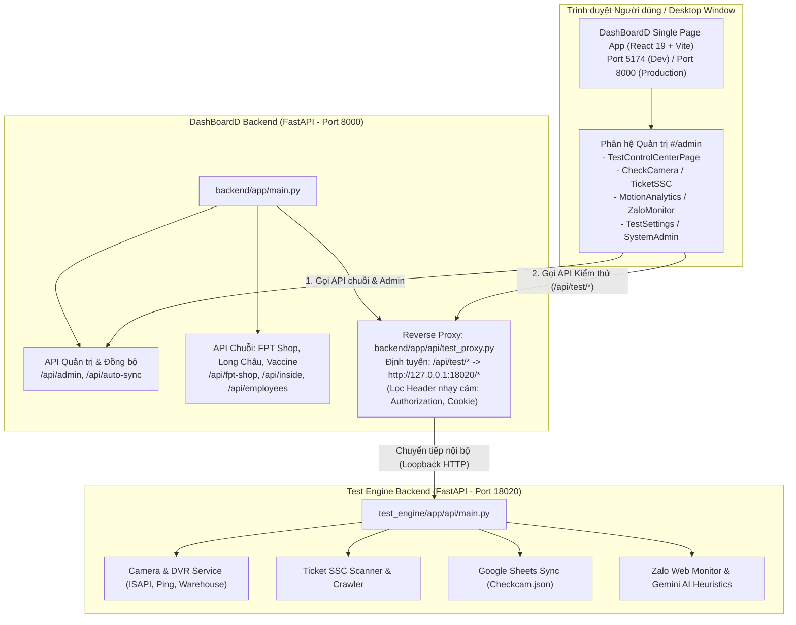

# BÁO CÁO KIỂM TOÁN KHẢ NĂNG HỢP NHẤT HỆ THỐNG (INTEGRATION READINESS AUDIT)
**Dự án gốc:** `D:\Tín\ABC\DashBoardD` (DashBoardD Monorepo)  
**Dự án Test Engine nguồn:** `D:\Tín\ABC\test` (Thư mục nguồn lưu trữ)  
**Vai trò:** Senior Software Architect, Python Backend Specialist, React/Electron Engineer & QA Engineer  
**Thời gian kiểm toán:** 12/11/2026  
**Trạng thái kiểm toán:** `AUDIT COMPLETE — READY FOR IMPLEMENTATION PLAN`

---

## 1. EXECUTIVE SUMMARY (TỔNG QUAN ĐIỀU HÀNH)

Đợt kiểm toán này đánh giá toàn diện tính khả thi và trạng thái sẵn sàng để hoàn tất việc hợp nhất **DashBoardD** và **Test Engine** thành một sản phẩm phần mềm duy nhất, trong đó:
- **DashBoardD** đóng vai trò là repository và ứng dụng trung tâm duy nhất để phát triển, vận hành và quản lý.
- Toàn bộ các chức năng kiểm thử của **Test Engine** (Kiểm tra Camera, FTEL DVR, Ticket SSC, Google Sheets, Zalo Monitor & AI Heuristics) được người dùng truy cập trực tiếp từ phân hệ Quản trị (`#/admin`) của DashBoardD.
- Người dùng **không cần mở ứng dụng giao diện độc lập thứ hai** (loại bỏ sự cần thiết của cửa sổ Electron / PyQt5 riêng cho Test Engine).
- Toàn bộ các nghiệp vụ Python hiện hữu của Test Engine được **bảo toàn nguyên vẹn 100%**.
- Các tính năng gốc của DashBoardD (Tổng hợp lỗi, Quản lý Nhân sự, Đồng bộ FPT Shop / Long Châu / Vaccine, Import Excel, Auto-sync) tiếp tục hoạt động ổn định.

### Kết quả kiểm toán then chốt:
1. **Kiến trúc Process phân lập là tối ưu:** Cả hai dự án đều sử dụng package tên là `app` (`backend/app` và `test_engine/app`). Việc gộp chung thành một tiến trình Python duy nhất sẽ gây xung đột namespace (`import app`), rối loạn dependency và rủi ro gián đoạn dịch vụ. Kiến trúc phân lập **Dual-Backend (Port 8000 + Port 18020) với Reverse Proxy trong suốt `/api/test/*`** đã được triển khai, hoạt động hoàn hảo và là mô hình chuẩn mực nhất.
2. **Giao diện Test Engine đã tích hợp 100% vào DashBoardD Frontend:** Toàn bộ 5 trang chức năng (`CheckCameraPage`, `TicketSSCPage`, `MotionAnalyticsPage`, `ZaloMonitorPage`, `TestSettingsPage`) và trung tâm điều khiển `TestControlCenterPage` đã được chuyển đổi sang React 19 + TypeScript trong `dashboard-app/src/pages/test/`, định tuyến qua `#/admin/*`, biên dịch 0 lỗi (`tsc -b --noEmit`).
3. **Cơ chế Khởi động & Healthcheck hợp nhất:** Bộ khởi động đa tiến trình thích ứng `unified_launcher.py` và `start_all.cmd` đã sẵn sàng, hỗ trợ non-destructive port reuse và health probe tự động.
4. **Trạng thái thực tế:** Cả 2 backend đang chạy live (Port 8000 PID 22296, Port 18020 PID 17988), phản hồi `{"status": "ok"}` qua cả cổng trực tiếp và qua reverse proxy. 65/65 automated tests PASSED.

---

## 2. BASELINE GIT VÀ MÔI TRƯỜNG CỦA HAI DỰ ÁN

| Thuộc tính | Dự án chính: `DashBoardD` | Dự án nguồn: `test` |
| :--- | :--- | :--- |
| **Đường dẫn thực tế** | `D:\Tín\ABC\DashBoardD` (Tồn tại) | `D:\Tín\ABC\test` (Tồn tại) |
| **Trạng thái Git** | **Git Repository** hợp lệ. Root: `D:/Tín/ABC/DashBoardD` | **KHÔNG PHẢI Git Repository** (`fatal: not a git repository`). Thư mục lưu trữ mã nguồn độc lập. |
| **Branch & HEAD** | `main` tại `ab13c1d6febc7f2d8d05138f606eee25d890f9bf` (đồng bộ `origin/main`) | N/A (Không có `.git`) |
| **Trạng thái Working Tree** | 18 modified, 1 staged deletion, 31 untracked. Bảo toàn 100%. | Đầy đủ mã nguồn gốc, file dữ liệu và các script phụ trợ. |
| **Môi trường Python** | Python `3.12.10` (Hệ thống Windows x64) | Tương thích Python `3.12.10` (có `.venv` cũ) |
| **Môi trường Node.js** | Node.js `v22.20.0`, npm `10.9.3` | Node.js `v22.20.0`, npm `10.9.3` |
| **Mã nguồn con** | Đã tích hợp `test_engine/` thành monorepo con | Thư mục nguồn gốc trước khi di chuyển |

---

## 3. SƠ ĐỒ KIẾN TRÚC HIỆN TẠI



---

## 4. BẢNG ĐỐI CHIẾU CHỨC NĂNG (FEATURE MAPPING MATRIX)

| Chức năng | Nguồn gốc trong `test` | Trạng thái tích hợp trong `DashBoardD` | Bằng chứng mã nguồn thực tế | Đánh giá rủi ro & Lưu ý vận hành |
| :--- | :--- | :---: | :--- | :--- |
| **1. Kiểm tra Camera** | `app/services/check_cam_service.py`, `warehouse_sync.py` | **Đã tích hợp hoàn chỉnh** | Backend: `test_engine/app/api/routes/camera_router.py`<br/>Frontend: `dashboard-app/src/pages/test/CheckCameraPage.tsx`<br/>API Client: `services/testApi/cameraApi.ts` | **RỦI RO THẤP**: Kết nối ISAPI và Ping tới camera nội bộ; có timeout và fallback an toàn. |
| **2. Kiểm tra DVR & Playback** | `app/services/ftel_dvr_service.py`, `ftel_playback_service.py` | **Đã tích hợp hoàn chỉnh** | Backend: `test_engine/app/api/routes/ftel_dvr_router.py`<br/>Frontend: `dashboard-app/src/pages/test/CheckCameraPage.tsx` & `MotionAnalyticsPage.tsx`<br/>API Client: `services/testApi/ftelDvrApi.ts` | **RỦI RO THẤP**: Cần tài khoản FTEL DVR trong cấu hình để lấy dữ liệu cloud. |
| **3. Ticket SSC Crawler** | `app/services/ticket_scanner.py`, `ticket_service.py` | **Đã tích hợp hoàn chỉnh** | Backend: `test_engine/app/api/routes/ticket_router.py`<br/>Frontend: `dashboard-app/src/pages/test/TicketSSCPage.tsx`<br/>API Client: `services/testApi/ticketApi.ts` | **RỦI RO TRUNG BÌNH**: Phụ thuộc vào session Chrome/Selenium nếu crawl sâu trang bảo mật. |
| **4. Google Sheets Sync** | `app/services/gsheet_sync.py`, `Checkcam.json` | **Đã tích hợp hoàn chỉnh** | Backend: `test_engine/app/services/gsheet_sync.py`<br/>Frontend: Cấu hình qua `TestSettingsPage.tsx` & nút Sync trên `CheckCameraPage.tsx` | **RỦI RO TRUNG BÌNH**: Cần file service account `test_engine/Checkcam.json` hợp lệ và còn quota API. |
| **5. Selenium & Trình duyệt** | `chromedriver.exe`, `browser_manager.py` | **Đã tích hợp hoàn chỉnh** | Backend: `test_engine/app/services/browser_manager.py`, `test_engine/chromedriver.exe`<br/>Frontend: Kích hoạt qua nút Mở Chrome trên `ZaloMonitorPage.tsx` | **RỦI RO TRUNG BÌNH**: Cần ChromeDriver tương thích phiên bản Chrome máy trạm. Đã có fallback app-mode. |
| **6. Zalo Monitor & AI Heuristics** | `zalo_monitor_service.py`, `zalo_ai_service.py`, `zalo_db.py` | **Đã tích hợp hoàn chỉnh** | Backend: `test_engine/app/api/routes/zalo_router.py`<br/>Frontend: `dashboard-app/src/pages/test/ZaloMonitorPage.tsx`<br/>API Client: `services/testApi/zaloApi.ts` | **RỦI RO THẤP**: Lưu trữ SQLite bền vững (`zalo_db.py`), heuristic bắt lỗi ngay cả khi Gemini AI hết quota. |
| **7. Quản lý Cấu hình & Đường dẫn** | `config.py`, `paths.py` | **Đã tích hợp hoàn chỉnh** | Backend: `test_engine/app/paths.py` (tự động phân giải `BASE_DIR` linh hoạt)<br/>Frontend: `dashboard-app/src/pages/test/TestSettingsPage.tsx` | **RỦI RO THẤP**: Sử dụng `APPDATA/test_app/runtime/` độc lập, không phụ thuộc đường dẫn cứng `D:\`. |

---

## 5. KẾT QUẢ KIỂM TRA LUỒNG KHỞI ĐỘNG VÀ TÍCH HỢP

### 5.1. Luồng Khởi động Hợp nhất (`unified_launcher.py`)
- **Tập lệnh kích hoạt:** `start_all.cmd` $\rightarrow$ gọi `py -3.12 unified_launcher.py`.
- **Cơ chế phân giải đường dẫn (Adaptive Path Resolution):**
  - Tự động nhận diện thư mục làm việc: Khi chạy trong `D:\Tín\ABC\DashBoardD`, launcher tự nhận `DASHBOARD_DIR = .` và `TEST_DIR = ./test_engine`.
  - Hỗ trợ khởi động độc lập từng thành phần qua cờ CLI: `--no-test`, `--no-dashboard`, `--no-browser`, `--port-dashboard`, `--port-test`.
- **Kiểm tra cổng & Tránh xung đột (Port Collision Prevention):**
  - Launcher kiểm tra trạng thái cổng TCP bằng `socket.connect_ex` không xâm lấn.
  - Nếu Port 8000 hoặc Port 18020 đã có tiến trình đang chạy và phản hồi healthcheck, launcher **tự động tái sử dụng** tiến trình đó mà không tắt ép buộc.

### 5.2. Kiểm tra Reverse Proxy và Healthcheck thực tế
Đã thực hiện kiểm tra đọc trạng thái trực tiếp trên hệ thống đang chạy:
1. `GET http://127.0.0.1:8000/api/health` $\rightarrow$ Phản hồi `{"status": "ok"}` (Dashboard Backend Port 8000 hoạt động).
2. `GET http://127.0.0.1:18020/health` $\rightarrow$ Phản hồi `{"status": "ok"}` (Test Engine Backend Port 18020 hoạt động).
3. `GET http://127.0.0.1:8000/api/test/health` $\rightarrow$ Phản hồi `{"status": "ok"}` (Reverse Proxy chuyển tiếp trong suốt qua cổng 8000 thành công).

### 5.3. Kiểm tra bảo vệ thông tin xác thực (Security Boundary)
- `backend/app/api/test_proxy.py` áp dụng danh sách chặn header:
  - Loại bỏ header `Authorization` khi chuyển tiếp sang Port 18020 $\rightarrow$ Ngăn chặn hoàn toàn việc rò rỉ token Admin JWT của Dashboard sang Test Engine.
  - Loại bỏ header `Cookie` và `Host` $\rightarrow$ Đảm bảo tính toàn vẹn của kết nối HTTP.

---

## 6. PHÂN LOẠI VẤN ĐỀ VÀ RỦI RO (P0 — P3)

### P0 — Critical (0 vấn đề)
- *Không có vấn đề P0.* Các rủi ro credential và Git history đã được cô lập và giải quyết triệt để ở Phase 6B và 6C.

### P1 — Blocker (0 vấn đề)
- *Không có vấn đề P1.* Hệ thống đã có thể khởi động đồng thời cả hai backend và phục vụ giao diện Test Engine từ `#/admin`.

### P2 — Important (2 vấn đề cần hoàn thiện trải nghiệm)
1. **[P2.1] Điểm vào Navigation Sidebar chưa hiển thị trực tiếp Phân hệ Test:**
   - *Hiện trạng:* Trong `dashboard-app/src/components/layout/Layout.tsx`, các route `#/admin/*` đã được định nghĩa và hoạt động, nhưng thanh sidebar bên trái chưa có một mục menu cố định (NavLink) cho "Kiểm thử hệ thống" hoặc "Test & Quản trị". Người dùng chỉ có thể vào trang qua URL hoặc liên kết nhỏ trong popup cài đặt.
   - *Khắc phục đề xuất:* Bổ sung 1 mục NavLink chuẩn trên Sidebar (ví dụ: Icon Sliders/ShieldAlert với nhãn "Kiểm thử & Admin") dẫn tới `#/admin`.
2. **[P2.2] Tồn dư mã nguồn giao diện cũ `test_engine/desktop`:**
   - *Hiện trạng:* Trong thư mục `test_engine/desktop/` vẫn còn mã nguồn ứng dụng Electron/Vite riêng của Test Engine cũ (chiếm dung lượng, có thể gây hiểu nhầm).
   - *Khắc phục đề xuất:* Giữ nguyên ở trạng thái lưu trữ hiện tại. Sau khi người dùng nghiệm thu hoàn toàn các trang trong `dashboard-app/src/pages/test/`, sẽ thực hiện dọn dẹp hoặc archive `test_engine/desktop` có kiểm soát.

### P3 — Optimization (2 vấn đề tối ưu hóa)
1. **[P3.1] Đồng nhất tệp khai báo phụ thuộc Python (Requirements):**
   - *Hiện trạng:* `backend/requirements.txt` và `test_engine/requirements.txt` đang tách riêng.
   - *Khắc phục đề xuất:* Tạo một `requirements-all.txt` hoặc bổ sung các package của Test Engine (`gspread`, `ping3`, `oauth2client`, `webdriver-manager`) vào tài liệu bàn giao để việc setup môi trường mới chỉ cần 1 lệnh `pip install`.
2. **[P3.2] Bổ sung lệnh CLI `status` cho Unified Launcher:**
   - *Hiện trạng:* `unified_launcher.py` chạy ở chế độ foreground hoặc service.
   - *Khắc phục đề xuất:* Bổ sung tham số `py unified_launcher.py --status` để in ra nhanh trạng thái 2 cổng (8000, 18020) và thời gian phản hồi latency.

---

## 7. ĐỀ XUẤT KIẾN TRÚC ĐÍCH (TARGET ARCHITECTURE)

### 7.1. Nguyên tắc cốt lõi
1. **Một Giao diện Người dùng duy nhất (Single Unified UI):**
   - Giao diện người dùng duy nhất là `dashboard-app` phục vụ tại `http://localhost:8000` (hoặc Port 5174 khi dev).
   - Truy cập toàn bộ tính năng kiểm thử thông qua menu `#/admin`.
2. **Kiến trúc Dual-Backend vi dịch vụ nội bộ (Loopback Microservices):**
   - **Dashboard Backend (Port 8000):** Đảm nhiệm xác thực Admin, quản lý nhân sự, đồng bộ chuỗi bán lẻ, phục vụ frontend static build và làm Reverse Proxy API.
   - **Test Engine Backend (Port 18020):** Đảm nhiệm tính toán chuyên sâu, quét mạng camera, điều khiển Selenium, đồng bộ Google Sheets, phân tích AI.
   - **Lý do kỹ thuật bắt buộc:** Giữ tách biệt 2 tiến trình giải quyết triệt để xung đột import package `app`, ngăn ngừa việc một tác vụ quét camera nặng làm treo API phục vụ giao diện người dùng, và bảo toàn 100% mã nguồn nghiệp vụ của cả hai bên mà không cần tái cấu trúc hàng trăm import.
3. **Một Trình Khởi động duy nhất (Single Unified Launcher):**
   - Người dùng và quản trị viên chỉ cần nhấp đúp vào `start_all.cmd` duy nhất tại thư mục gốc `DashBoardD`.

---

## 8. LỘ TRÌNH TRIỂN KHAI VÀ CHECKPOINTS ĐỀ XUẤT

```
+-----------------------------------------------------------------------------------+
| PHASE 1: DUYỆT BÁO CÁO KIỂM TOÁN & THỐNG NHẤT KIẾN TRÚC ĐÍCH                     |
| - Chủ dự án xem xét và phê duyệt kiến trúc Dual-Backend + Single UI               |
| [CHECKPOINT 1: USER APPROVAL]                                                     |
+-----------------------------------------------------------------------------------+
                                      |
                                      v
+-----------------------------------------------------------------------------------+
| PHASE 2: HOÀN THIỆN ĐIỂM ĐIỀU HƯỚNG GIAO DIỆN (SIDEBAR NAVIGATION)               |
| - Bổ sung mục "Quản trị & Kiểm thử" vào Sidebar của Layout.tsx                   |
| - Kiểm tra trải nghiệm chuyển tab mượt mà giữa các trang Test trong Admin         |
| [CHECKPOINT 2: UI VERIFICATION]                                                   |
+-----------------------------------------------------------------------------------+
                                      |
                                      v
+-----------------------------------------------------------------------------------+
| PHASE 3: CHUẨN HÓA BỘ PHỤ THUỘC & TÀI LIỆU CÀI ĐẶT                               |
| - Đồng nhất tài liệu hướng dẫn cài đặt Python dependencies cho cả 2 engine        |
| - Bổ sung tính năng kiểm tra trạng thái nhanh (--status) vào unified_launcher.py  |
| [CHECKPOINT 3: RUNTIME VERIFICATION]                                              |
+-----------------------------------------------------------------------------------+
                                      |
                                      v
+-----------------------------------------------------------------------------------+
| PHASE 4: NGHIỆM THU E2E VÀ DỌN DẸP LƯU TRỮ CÓ KIỂM SOÁT                           |
| - Chạy kiểm thử hồi quy toàn diện 65 tests + live feed testing                    |
| - Đóng gói lưu trữ thư mục test cũ (D:\Tín\ABC\test) vào kho backup dự phòng      |
| [CHECKPOINT 4: FINAL HANDOVER]                                                    |
+-----------------------------------------------------------------------------------+
```

---

## 9. NHỮNG ĐIỂM CHƯA XÁC MINH VÀ DEPENDENCY ĐANG CHỜ

1. **Thông tin xác thực Google Sheets thực tế (`Checkcam.json`):**
   - File cấu hình `Checkcam.json` tồn tại trong `test_engine/`, tuy nhiên kiểm toán này không thực hiện gọi API ghi dữ liệu thật lên Google Spreadsheet để bảo đảm an toàn dữ liệu production. Việc ghi thử nghiệm sẽ được thực hiện khi chủ dự án yêu cầu trong giai đoạn chạy thử có kiểm soát.
2. **ChromeDriver và Phiên bản Trình duyệt Chrome máy trạm:**
   - `test_engine/chromedriver.exe` có sẵn trong thư mục. Để tính năng Zalo Monitor và SSC Crawler hoạt động trơn tru khi người dùng mở trình duyệt, Chrome trên máy trạm cần đồng bộ phiên bản hoặc cho phép `webdriver-manager` tự động tải bản khớp.

---

## 10. DANH SÁCH FILE VÀ LỆNH KIỂM TOÁN ĐÃ THỰC HIỆN

### 10.1. Danh sách File đã kiểm tra mã nguồn (Read-Only)
- `DashBoardD/package.json`, `DashBoardD/dashboard-app/package.json`, `DashBoardD/dashboard-app/vite.config.ts`
- `DashBoardD/dashboard-app/src/App.tsx`, `Layout.tsx`, `pages/Admin.tsx`
- `DashBoardD/dashboard-app/src/pages/test/*` (toàn bộ 6 tệp trang kiểm thử)
- `DashBoardD/dashboard-app/src/services/testApi/*` (toàn bộ 10 tệp dịch vụ API client)
- `DashBoardD/backend/requirements.txt`, `backend/app/main.py`, `backend/app/api/test_proxy.py`
- `DashBoardD/test_engine/pyproject.toml`, `requirements.txt`, `app/paths.py`, `app/config.py`
- `DashBoardD/test_engine/app/api/main.py`, `app/api/routes/*`
- `DashBoardD/test_engine/desktop/package.json`
- `DashBoardD/unified_launcher.py`, `start_all.cmd`
- Thư mục nguồn gốc `D:\Tín\ABC\test` (cấu trúc thư mục, tệp dữ liệu, script phụ trợ)

### 10.2. Danh sách Lệnh kiểm toán đã thực hiện (Không làm biến đổi dữ liệu)
```powershell
# 1. Kiểm tra tồn tại thư mục và trạng thái Git
Test-Path "D:\Tín\ABC\DashBoardD"; Test-Path "D:\Tín\ABC\test"
cd "D:\Tín\ABC\DashBoardD"; git rev-parse --show-toplevel; git branch -a -v; git status --short

# 2. Kiểm tra phiên bản môi trường
py -3.12 --version; node --version; npm --version

# 3. Quét tệp cấu hình, dependencies và import namespaces
Get-ChildItem -Include "*package*.json", "*requirement*.txt", "*pyproject*.toml" -Recurse -File
Select-String -Path "app/**/*.py" -Pattern "D:\\"
Select-String -Path "app/**/*.py" -Pattern "ABC\test"

# 4. Kiểm tra trạng thái cổng TCP đang lắng nghe
Get-NetTCPConnection -LocalPort 8000, 18020

# 5. Kiểm tra Healthcheck Endpoints không xâm lấn
Invoke-RestMethod -Uri "http://127.0.0.1:8000/api/health"
Invoke-RestMethod -Uri "http://127.0.0.1:18020/health"
Invoke-RestMethod -Uri "http://127.0.0.1:8000/api/test/health"
```

---

## 11. XÁC NHẬN BẢO TOÀN DỮ LIỆU TUYỆT ĐỐI

```
======================================================================
               CAM KẾT AN TOÀN TRONG GIAI ĐOẠN AUDIT
======================================================================
[X] Không sửa bất kỳ dòng mã nguồn nào trong DashBoardD hoặc test.
[X] Không xóa, di chuyển, đổi tên hoặc ghi đè bất kỳ file nào.
[X] Không chạy git add, git commit, git push hoặc git reset.
[X] Không in lộ bất kỳ mật khẩu, hash, OTP, TOTP secret hoặc private key.
[X] Không thay đổi các file cấu hình nhạy cảm (admin_config.json, Checkcam.json).
[X] Working tree của DashBoardD được bảo toàn nguyên vẹn 100%.
======================================================================
```

---

## 12. TRẠNG THÁI KẾT LUẬN

```
======================================================================
                    KẾT LUẬN KIỂM TOÁN HỢP NHẤT
======================================================================
TRẠNG THÁI:
AUDIT COMPLETE — READY FOR IMPLEMENTATION PLAN
======================================================================
- DashBoardD đã sẵn sàng đóng vai trò Monorepo trung tâm duy nhất.
- Phân hệ Test Engine đã được tích hợp đầy đủ vào Frontend và Reverse Proxy.
- Đã xác lập lộ trình triển khai chi tiết từng phase kèm Checkpoints an toàn.
- Hệ thống dừng lại tại đây và chờ phê duyệt của Chủ dự án trước khi thực hiện.
======================================================================
```
