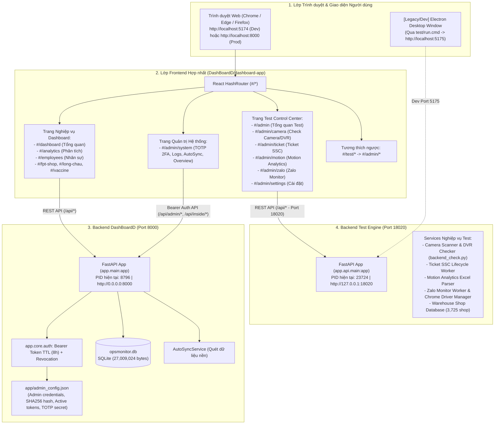

# KẾ HOẠCH THIẾT KẾ UNIFIED LAUNCHER & AUDIT SẴN SÀNG VẬN HÀNH (PHASE 7.0)

**Thời gian lập kế hoạch:** 11/11/2026  
**Dự án:** `DashBoardD` (Hệ thống giám sát chính) tích hợp module `test` (Ứng dụng Test & Kiểm thử hạ tầng)  
**Chuyên môn áp dụng:** Full-Stack Architect & System Integration Engineer  
**Trạng thái tài liệu:** KẾ HOẠCH & AUDIT (CHỜ PHÊ DUYỆT - CHƯA SỬA CODE PRODUCTION)

---

## 1. SƠ ĐỒ KIẾN TRÚC HIỆN TẠI

Hệ thống sau khi hoàn thành Phase 6C vận hành dưới mô hình kiến trúc phân tán gồm 2 Backend độc lập và 1 Frontend hợp nhất (vẫn duy trì song song giao diện Electron cũ của Test phục vụ dev):



---

## 2. KIỂM KÊ ENTRY POINTS VÀ SCRIPTS THỰC TẾ

### 2.1. Thư mục gốc và cấu trúc dự án
- **Root 1 (Dashboard Chính):** `D:\Tín\ABC\DashBoardD`
  - Backend: `D:\Tín\ABC\DashBoardD\backend`
  - Frontend: `D:\Tín\ABC\DashBoardD\dashboard-app`
- **Root 2 (Module Test & Tools):** `D:\Tín\ABC\test`
  - Backend: `D:\Tín\ABC\test\app`
  - Legacy Desktop UI: `D:\Tín\ABC\test\desktop`

### 2.2. Danh sách Entry Points và Scripts hiện hữu

| Tệp tin / Lệnh khởi chạy | Vị trí thư mục | Nhiệm vụ thực tế | Tình trạng hiện tại |
| :--- | :--- | :--- | :--- |
| `test/run.cmd` | `D:\Tín\ABC\test\` | Gọi `cd desktop && npm run electron:dev`. Mở đồng thời Vite port 5175 và Electron Window. | **BẢO TOÀN NGUYÊN VẸN** (Dành cho dev muốn chạy riêng Electron) |
| `test backend startup` | `D:\Tín\ABC\test\` | `python -m uvicorn app.api.main:app --host 127.0.0.1 --port 18020 --no-access-log` | Đang chạy với PID 23724 |
| `DashBoardD/start_dev.bat` | `D:\Tín\ABC\DashBoardD\` | Gọi `py -3.12 run_dev.py`. Chạy đồng thời Backend port 8000 và Vite frontend port 5174 trong 1 cửa sổ CMD. | Đang sử dụng |
| `DashBoardD/start_server.bat` | `D:\Tín\ABC\DashBoardD\` | Giải phóng port 8000 (cũ) và chạy FastAPI backend port 8000 ở chế độ phục vụ production (`dist`). | Đang sử dụng |
| `DashBoardD/start_unified.bat` | `D:\Tín\ABC\DashBoardD\` | Kiểm tra nếu chưa build `dist` thì chạy `npm run build`, sau đó chạy backend port 8000. | Đang sử dụng |
| `DashBoardD/run_dev.py` | `D:\Tín\ABC\DashBoardD\` | Script Python đa tiến trình quản lý song song backend (8000) và Vite frontend (5174). | Script mẫu tốt để mở rộng |
| `DashBoardD/open_desktop_app.bat` | `D:\Tín\ABC\DashBoardD\` | Chạy `npm run electron:preview` trong `dashboard-app`. | Tuỳ chọn |

---

## 3. MA TRẬN PORT, HEALTH ENDPOINT & DEPENDENCY

| Dịch vụ | Port | Host binding | Health Check Endpoint | Phản hồi Health chuẩn | Ràng buộc phụ thuộc (Dependency) |
| :--- | :---: | :---: | :--- | :--- | :--- |
| **DashBoardD Backend** | `8000` | `0.0.0.0` | `GET http://127.0.0.1:8000/api/health` | `HTTP 200` `{"status":"ok"}` | Cần Python 3.12, tệp DB `opsmonitor.db` và `admin_config.json`. |
| **Test Backend Engine** | `18020` | `127.0.0.1` | `GET http://127.0.0.1:18020/health` | `HTTP 200` `{"success":true,"status":"ok","service":"test-python-backend"}` | Cần Python 3.12, thư viện Selenium, pandas, openpyxl, gspread. Chạy độc lập hoàn toàn với port 8000. |
| **Frontend Dev (Vite)** | `5174` | `0.0.0.0` | `GET http://localhost:5174` | `HTTP 200` (HTML response) | Phụ thuộc vào Backend 8000 (để nạp số liệu) và Backend 18020 (để nạp dữ liệu Test). |
| **Frontend Prod (FastAPI)** | `8000` | `0.0.0.0` | `GET http://localhost:8000/` | `HTTP 200` (HTML từ `dashboard-app/dist`) | Yêu cầu `dashboard-app/dist` đã được biên dịch (`npm run build`). |

### Cơ chế phân giải URL và Biến môi trường:
- **DashBoardD API URL:** Được xác định tự động qua hàm `getApiBaseUrl()` trong [`apiConfig.ts`](file:///D:/T%C3%ADn/ABC/DashBoardD/dashboard-app/src/services/apiConfig.ts). Nếu truy cập qua port 5174, tự động trỏ API về `http://<hostname>:8000`. Nếu chạy production trên port 8000, trỏ về `window.location.origin`.
- **Test Engine API URL:** Được xác định tự động qua hàm `getTestApiBaseUrl()` trong [`testApi/config.ts`](file:///D:/T%C3%ADn/ABC/DashBoardD/dashboard-app/src/services/testApi/config.ts). Ưu tiên `VITE_TEST_API_URL` -> `window.__TEST_API_BASE_URL__` -> Fallback mặc định an toàn: `http://127.0.0.1:18020`.

---

## 4. PHƯƠNG ÁN UNIFIED LAUNCHER ĐỀ XUẤT

### 4.1. Lựa chọn kiến trúc kỹ thuật
Đề xuất sử dụng mô hình **Dual-Layer Launcher (Python Core + Batch Wrapper)**:
1. **Core Launcher (`unified_launcher.py`):** Viết bằng Python 3.12 tiêu chuẩn (không cần cài thêm thư viện bên ngoài, tận dụng `subprocess`, `urllib.request`, `socket`, `time`, `signal`, `json`).
2. **Batch Wrapper (`start.cmd` hoặc `run_all.cmd`):** Tệp batch 3 dòng đặt tại thư mục mẹ `D:\Tín\ABC\` hoặc `DashBoardD\`, cho phép người dùng click đúp chuột trực tiếp trên Windows Explorer mà không cần mở sẵn terminal.

### 4.2. Nguyên tắc hoạt động thông minh (Smart Lifecycle Management)

```mermaid
flowchart TD
    Start([Người dùng chạy start.cmd]) --> PreflightCheck[1. Pre-flight Check:\n- Kiểm tra Python 3.12, Node.js, npm\n- Kiểm tra tệp opsmonitor.db, admin_config.json]
    
    PreflightCheck -->|Lỗi thiếu runtime| ShowError[Hiển thị cảnh báo rõ ràng & dừng]
    PreflightCheck -->|Hợp lệ| PortAudit[2. Khảo sát trạng thái Port:\n- Kiểm tra port 8000 & 18020]
    
    PortAudit --> PortCheck{Port đã có dịch vụ chạy?}
    PortCheck -->|Đúng dịch vụ & Health OK| ReuseService[Ghi nhận dịch vụ đã có sẵn, KHÔNG KILL, tái sử dụng]
    PortCheck -->|Port bị chiếm bởi tiến trình lạ| AlertConflict[Cảnh báo xung đột port kèm PID & Tên tiến trình -> Dừng an toàn]
    PortCheck -->|Port trống| SpawnService[3. Khởi chạy dịch vụ theo thứ tự:\n- Bước A: Khởi động Test Backend 18020\n- Bước B: Khởi động DashBoardD Backend 8000]
    
    ReuseService --> HealthGate[4. Cổng kiểm tra Health Check Gate:\n- Poll 127.0.0.1:18020/health tối đa 15s\n- Poll 127.0.0.1:8000/api/health tối đa 15s]
    SpawnService --> HealthGate
    
    HealthGate -->|Một backend fail| ReportFail[Báo lỗi dịch vụ thất bại & dừng graceful các tiến trình con vừa tạo]
    HealthGate -->|Cả 2 backend OK| LaunchFrontend[5. Khởi chạy Frontend:\n- Chế độ Dev: npm run dev port 5174\n- Chế độ Prod: Phục vụ trực tiếp port 8000]
    
    LaunchFrontend --> OpenBrowser[6. Mở trình duyệt Web mặc định tại URL tương ứng]
    OpenBrowser --> MonitorLoop[7. Vòng lặp giám sát (Watchdog Loop):\n- Theo dõi sức khỏe tiến trình\n- Lắng nghe sự kiện Ctrl+C]
    
    MonitorLoop -->|Bấm Ctrl+C| CleanShutdown[8. Dừng có kiểm soát:\n- CHỈ dừng các tiến trình con do launcher tạo ra\n- TUYỆT ĐỐI KHÔNG kill tiến trình độc lập của người dùng]
    CleanShutdown --> End([Thoát an toàn])
```

### 4.3. Các tính năng cốt lõi của Launcher:
- **Pre-flight Check:** Kiểm tra sự sẵn sàng của môi trường (`python.exe`, `npm`, `node`), kiểm tra sự tồn tại của database và tệp cấu hình mà không sửa đổi nội dung.
- **Không bao giờ Kill bừa bãi:** Khác với script batch cũ thường dùng lệnh `taskkill /f /pid` cưỡng chế, launcher mới sẽ gửi request health check trước. Nếu port 8000 đã là DashBoardD backend hoặc port 18020 đã là Test backend đang chạy, launcher sẽ tự động kết nối và sử dụng tiếp mà không khởi động đè hoặc ngắt quãng phiên làm việc hiện tại.
- **Kiểm soát PID chính xác:** Launcher ghi nhận danh sách PIDs của chính các tiến trình con mà nó tạo ra trong phiên đó. Khi người dùng bấm `Ctrl + C`, launcher CHỈ gửi lệnh dừng tới các tiến trình thuộc danh sách này.
- **Hỗ trợ 2 chế độ linh hoạt:**
  - `start.cmd` hoặc `python unified_launcher.py --mode dev`: Dành cho lập trình viên (chạy đồng thời Backend 8000, Test 18020, Vite 5174 với Hot Module Reload).
  - `python unified_launcher.py --mode prod`: Dành cho triển khai nội bộ (chạy Backend 8000 và Test 18020; port 8000 tự phục vụ giao diện tĩnh từ `dist`).
  - `python unified_launcher.py --status`: Chỉ kiểm tra tình trạng sức khỏe của các service mà không khởi động bất kỳ tiến trình nào.

---

## 5. DANH SÁCH TỆP DỰ KIẾN TẠO / SỬA Ở PHASE 7.1

| Tệp tin | Vị trí | Thao tác | Mục đích |
| :--- | :--- | :---: | :--- |
| `start_all.cmd` (hoặc `start.cmd`) | `D:\Tín\ABC\` (Thư mục mẹ) | **Tạo mới** | Điểm nhấn đúp chuột 1-click tiện lợi nhất cho người dùng khởi chạy toàn bộ hệ thống. |
| `unified_launcher.py` | `D:\Tín\ABC\tools\` hoặc `DashBoardD\scripts\` | **Tạo mới** | Script trung tâm điều phối đa tiến trình, quản lý vòng đời và health check. |
| `test/run.cmd` | `D:\Tín\ABC\test\` | **BẢO TOÀN** | Giữ nguyên 100%, không chỉnh sửa bất kỳ dòng nào. |
| `DashBoardD/start_dev.bat` | `D:\Tín\ABC\DashBoardD\` | **BẢO TOÀN** | Giữ nguyên 100% để phục vụ dev độc lập Dashboard. |
| `DashBoardD/start_server.bat` | `D:\Tín\ABC\DashBoardD\` | **BẢO TOÀN** | Giữ nguyên 100% để phục vụ chạy server production độc lập. |
| `DashBoardD/backend/opsmonitor.db` | `D:\Tín\ABC\DashBoardD\backend\` | **BẢO TOÀN** | Tuyệt đối không chạm vào database. |
| `DashBoardD/backend/app/admin_config.json` | `D:\Tín\ABC\DashBoardD\backend\app\` | **BẢO TOÀN** | Tuyệt đối không ghi đè cấu hình bảo mật. |

---

## 6. PHÂN TÍCH RỦI RO & PHƯƠNG ÁN ROLLBACK

| Rủi ro tiềm ẩn | Mức độ | Nguyên nhân | Biện pháp phòng ngừa kỹ thuật | Phương án Rollback |
| :--- | :---: | :--- | :--- | :--- |
| **Xung đột Port khi khởi động** | Trung bình | Port 8000 hoặc 18020 bị chiếm bởi ứng dụng khác ngoài DashboardD/Test. | Launcher probe health endpoint. Nếu không phải dịch vụ hợp lệ, in rõ thông tin tiến trình xung đột (PID, ProcessName) và dừng an toàn, không taskkill. | Người dùng tự kiểm tra và đóng ứng dụng xung đột qua Task Manager. |
| **Kill nhầm tiến trình ngoài quyền** | Cao | Dùng lệnh `taskkill` chung chung theo port. | Launcher chỉ lưu danh sách `spawned_pids = []` và chỉ giải phóng các PID này khi shutdown. | Không xảy ra vì không dùng lệnh kill toàn cục. |
| **Trình duyệt mở trước khi backend sẵn sàng** | Thấp | Web browser bật lên khi server FastAPI chưa bind xong socket. | Launcher thiết lập vòng lặp thăm dò `check_health()` với timeout 15 giây. Chỉ khi cả 2 backend trả về HTTP 200 mới kích hoạt mở trình duyệt. | Không ảnh hưởng đến dữ liệu; người dùng chỉ cần F5. |
| **Sự cố khi người dùng đóng đột ngột (Close window)** | Thấp | Người dùng click nút X trên góc cửa sổ CMD thay vì bấm Ctrl+C. | Sử dụng `win32api.SetConsoleCtrlHandler` hoặc cờ `atexit` trong Python để dọn dẹp tiến trình con ngay cả khi đóng cửa sổ console. | Khởi động lại máy hoặc chạy lệnh `python unified_launcher.py --status`. |
| **Phương án Rollback toàn phần:** | Rất thấp | Nếu launcher gặp sự cố bất kỳ ở Phase 7.1. | Chỉ cần xóa tệp `unified_launcher.py` và `start_all.cmd`. Hệ thống ngay lập tức quay lại trạng thái hiện tại (chạy qua `start_dev.bat` hoặc lệnh uvicorn terminal độc lập). Không có rủi ro đối với code production! |

---

## 7. CÁC BƯỚC KIỂM THỬ KHÔNG GÂY TÁC DỤNG PHỤ (NON-DESTRUCTIVE TESTING)

1. **Kiểm thử Pre-flight (`--check` / `--status`):** Chạy kiểm tra tĩnh phát hiện các dịch vụ đang chạy, không bật thêm service và không tắt service hiện có.
2. **Kiểm thử Health Probe độc lập:** Sử dụng script Python gửi HTTP GET tới `http://127.0.0.1:8000/api/health` và `http://127.0.0.1:18020/health` để đo độ trễ và tính sẵn sàng mà không kích hoạt logic nghiệp vụ quét camera/ticket.
3. **Kiểm thử Xung đột Port an toàn:** Giả lập chạy launcher khi các dịch vụ đã đang online; xác nhận launcher nhận biết thông minh và báo `"Service already active (PID: ...)"` mà không crash hoặc tắt dịch vụ.
4. **Kiểm thử Khởi động & Shutdown có kiểm soát:** Chạy thử launcher trên môi trường isolated, ghi nhận PID được tạo ra, gửi tín hiệu ngắt (SIGINT) và xác minh chỉ đúng các PID đó kết thúc.
5. **Kiểm tra Checksum Database:** Luôn đối soát kích thước `27,009,024 bytes` và mã băm SHA256 của `opsmonitor.db` trước và sau mỗi lần thử nghiệm.

---

## 8. TIÊU CHÍ PASS / FAIL CHO PHASE 7.1

- **Tiêu chí 1 (Khởi động 1-click):** Chạy lệnh launcher duy nhất, cả 2 backend (8000 và 18020) và frontend khởi động thành công trong vòng dưới 10 giây mà không cần người dùng thao tác thủ công nhiều cửa sổ. -> **PASS** nếu cả 2 health checks đạt HTTP 200.
- **Tiêu chí 2 (Tái sử dụng an toàn):** Nếu một trong các service đã đang chạy từ trước, launcher tự động phát hiện và bỏ qua bước khởi động dịch vụ đó, không gây lỗi và không kill tiến trình cũ. -> **PASS**.
- **Tiêu chí 3 (Dừng có kiểm soát):** Khi nhấn `Ctrl + C`, toàn bộ các tiến trình do launcher tạo ra được đóng sạch sẽ, không để lại tiến trình ma (zombie process) chiếm dụng port. -> **PASS**.
- **Tiêu chí 4 (Bảo toàn nguyên vẹn):** Tệp `test/run.cmd` không bị sửa; `opsmonitor.db` giữ nguyên SHA256; cấu hình `admin_config.json` giữ nguyên mật khẩu băm và TOTP secret. -> **PASS**.

---

## 9. CÁC DEPENDENCY CHƯA XÁC ĐỊNH & CÂU HỎI CẦN QUYẾT ĐỊNH

Trước khi bắt tay vào triển khai mã nguồn ở Phase 7.1, kính trình Quản trị viên xem xét và cho ý kiến định hướng về 3 câu hỏi kiến trúc sau:

1. **Vị trí đặt tệp khởi chạy tiện lợi nhất:**
   - *Lựa chọn 1A:* Đặt `start_all.cmd` ngay tại thư mục mẹ `D:\Tín\ABC\` (ngang hàng với `DashBoardD` và `test`), giúp người dùng mở thư mục dự án là thấy ngay nút khởi chạy chung.
   - *Lựa chọn 1B:* Đặt bên trong thư mục `DashBoardD\` (ví dụ: `DashBoardD\start_all.bat`).
2. **Chế độ khởi chạy mặc định của 1-Click Launcher:**
   - *Lựa chọn 2A (Development Mode):* Chạy FastAPI 8000 + Test FastAPI 18020 + Vite Dev Server 5174. Ưu điểm: Phù hợp nhất cho lập trình và tinh chỉnh giao diện (hỗ trợ Hot-Reload).
   - *Lựa chọn 2B (Unified Production Mode):* Tự động kiểm tra build `dist` và chạy 2 backend; mở giao diện qua `http://localhost:8000`. Ưu điểm: Tiết kiệm tài nguyên RAM, mô phỏng đúng môi trường vận hành thực tế nhất.
   - *Lựa chọn 2C (Interactive Prompt):* Khi bật lên hiển thị menu nhỏ 2 lựa chọn: `[1] Chế độ Phát triển (Dev)` và `[2] Chế độ Vận hành (Prod)`.
3. **Cơ chế tự động mở trình duyệt (Auto-open Browser):**
   - Có nên tự động bật trình duyệt mặc định vào URL tương ứng sau khi hệ thống sẵn sàng không, hay chỉ in link trên console để người dùng tự bấm?

---

## 10. ĐIỂM DỪNG & CAM KẾT AN TOÀN

Báo cáo lập kế hoạch Phase 7.0 đã hoàn thành. 
- **Không có bất kỳ tệp code production nào bị sửa đổi.**
- **Không có tiến trình nào bị kill hoặc khởi động lại.**
- **Cơ sở dữ liệu `opsmonitor.db` và cấu hình quản trị được bảo toàn tuyệt đối.**

Hệ thống dừng tại đây và chờ phê duyệt chính thức từ Quản trị viên để tiến hành thực hiện **Phase 7.1 (Triển khai Unified Launcher)**.
