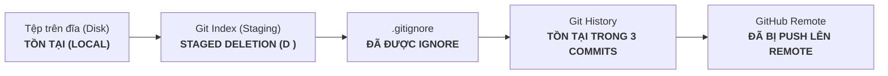
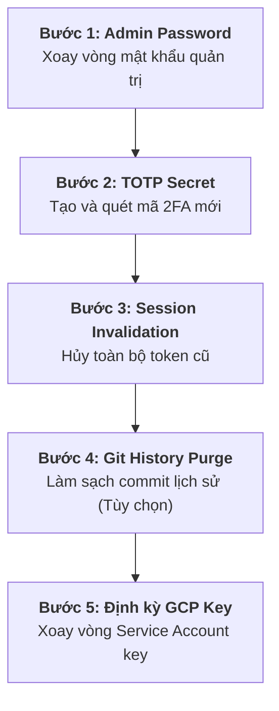
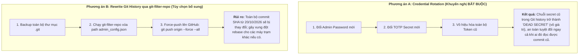

# BÁO CÁO PHASE 6A — ĐÁNH GIÁ BẢO MẬT VÀ LẬP KẾ HOẠCH XOAY VÒNG THÔNG TIN XÁC THỰC (SECURITY AUDIT & CREDENTIAL ROTATION PLANNING)

**Dự án:** DashBoardD + Test Engine Monorepo  
**Giai đoạn:** Phase 6A — Security Audit & Credential Rotation Planning  
**Thời gian thực hiện:** 11/11/2026  
**Trạng thái audit:** **COMPLETED — VERIFIED (100% READ-ONLY)**  
**Người thực hiện:** Senior Security Architect & DevOps Engineer  

---

## 1. TỔNG QUAN VÀ MỤC TIÊU PHASE 6A

Mục tiêu của Phase 6A là tiến hành kiểm toán bảo mật độc lập, thu thập bằng chứng kỹ thuật khách quan và lập kế hoạch xoay vòng thông tin xác thực (Credential Rotation) một cách có kiểm soát cho hệ thống DashBoardD và Test Engine.

### Nguyên Tắc An Toàn Tuân Thủ Tuyệt Đối:
- **100% Read-Only:** Không thay đổi working tree, không chạy `git add`, `git rm`, `git reset`, `git checkout`, `git clean`.
- **Không thay đổi Remote:** Không chạy `git push`, `git pull`, `git fetch`.
- **Bảo mật Secret:** Không in mật khẩu, hash, TOTP secret, token hay private key ra báo cáo hoặc console log.
- **Không can thiệp dịch vụ thật:** Không xóa session, không đăng xuất tài khoản, không chạy automation quét camera, không tạo ticket thật hay gửi tin nhắn Zalo.

---

## 2. BƯỚC A — XÁC MINH TRẠNG THÁI GIT VÀ REMOTE

Đã thực thi các lệnh truy vấn chỉ đọc để xác minh trạng thái kho lưu trữ Git chính tại `D:\Tín\ABC\DashBoardD`:

| Tiêu chí | Kết quả xác minh | Bằng chứng kỹ thuật |
| :--- | :--- | :--- |
| **Git Root** | `D:/Tín/ABC/DashBoardD` | `git rev-parse --show-toplevel` |
| **Current Branch** | `main` | `git branch --show-current` |
| **Commit HEAD** | `ab13c1d6febc7f2d8d05138f606eee25d890f9bf` | `git rev-parse HEAD` |
| **Remote Name** | `origin` | `git remote -v` |
| **Remote Host / Path** | Host: `github.com` \| Repo: `tinmt2/DashBoardD.git` | URL đã khử thông tin nhạy cảm: `https://github.com/tinmt2/DashBoardD.git` |
| **Upstream Branch** | `origin/main` | `git branch -vv`: `* main ab13c1d [origin/main]` |
| **Trạng thái đồng bộ** | **SYNCHRONIZED (IN-SYNC)** | Local `main` và remote `origin/main` cùng trỏ vào commit `ab13c1d`, không có chênh lệch commit (`0 ahead, 0 behind`). |
| **Xác minh Push History** | **CONFIRMED PUSHED** | Các commit chứa file nhạy cảm `admin_config.json` là tổ tiên của `origin/main` (`git merge-base --is-ancestor 5f418c3 HEAD` -> `True`). |

---

## 3. BƯỚC B — KIỂM KÊ LỊCH SỬ GIT CỦA `backend/app/admin_config.json`

Đã đối chiếu 5 trạng thái tồn tại của tệp `backend/app/admin_config.json`:



### 3.1. Chi tiết 5 Trạng thái Tồn tại

| Trạng thái | Hiện diện | Bằng chứng kỹ thuật |
| :--- | :---: | :--- |
| **1. Tồn tại vật lý trên đĩa** | **CÓ** | File tồn tại tại `D:\Tín\ABC\DashBoardD\backend\app\admin_config.json`. |
| **2. Đang được Git tracking trong index** | **KHÔNG** | Đã được untrack trong Phase 3 qua lệnh `git rm --cached`. Lệnh `git ls-files backend/app/admin_config.json` trả về rỗng. |
| **3. Trạng thái Staged Changes** | **CÓ** | Mang trạng thái `D ` trong `git status --short` (chờ commit staged deletion). |
| **4. Tồn tại trong lịch sử Commit** | **CÓ** | Tồn tại trong 3 commit lịch sử và tiếp tục duy trì trong cây snapshot đến commit HEAD `ab13c1d`. |
| **5. Đã từng Push hoặc Chia sẻ** | **CÓ** | Đã được đẩy lên nhánh `main` của repository GitHub `tinmt2/DashBoardD.git`. |

### 3.2. Bằng chứng Lịch sử Commit

| Commit SHA | Thời gian tạo (Timestamp) | Tác giả | Thông điệp commit | Blob Object ID |
| :--- | :--- | :--- | :--- | :--- |
| `9c6e374` | 20/10/2026 10:31:59 +0700 | tinmt2 | `feat: integrate shared Employee database and API, fix FPT sync date format` | `4c9e0c751c67a78c7560fbeb5918f0aefe7e3055` |
| `fe5c8d4` | 24/10/2026 12:02:35 +0700 | tinmt2 | `fix: resolve 7-hour timezone offset for sync notifications and streamline notification UI` | `8b6e80a2d5af55a0c4fc991a613a1432e5b881e3` |
| `5f418c3` | 26/10/2026 10:35:47 +0700 | tinmt2 | `fix: make auto-sync toggle instant-save and add 15m/30m quick select pills to prevent jumpback` | `49c64e5ae497292f36f140f88c5cbd3d09e28ded` |
| `ab13c1d` (HEAD) | 07/11/2026 10:53:21 +0700 | tinmt2 | `feat(employees): add 'Chuoi Inside' column placed directly after 'Ho va ten' with persistent selection` | `49c64e5ae497292f36f140f88c5cbd3d09e28ded` |

> [!CAUTION]
> **KẾT LUẬN QUAN TRỌNG:** Việc xóa file khỏi index (`git rm --cached`) hoặc thêm file vào `.gitignore` chỉ ngăn không cho các thay đổi mới được stage trong tương lai. Các blob chứa mật khẩu hash và TOTP secret cũ **VẪN NẰM NGUYÊN VẸN** trong cơ sở dữ liệu Git objects của repository và trên remote GitHub `tinmt2/DashBoardD`.

---

## 4. BƯỚC C & D — KIỂM KÊ CREDENTIAL, DỮ LIỆU NHẠY CẢM VÀ TRẠNG THÁI BẢO VỆ

Đã tiến hành rà soát toàn bộ các phân hệ của DashBoardD và Test Engine:

| Nhóm Credential | Đường dẫn tệp | Loại dữ liệu nhạy cảm | Trạng thái Git Tracking | Hiện diện trong Git History | Đã từng Push lên Remote | Mức độ rủi ro |
| :--- | :--- | :--- | :---: | :---: | :---: | :---: |
| **C1. Admin Auth** | `backend/app/admin_config.json` | - Unsalted SHA-256 password hash<br>- Base32 TOTP secret<br>- Session tokens (đã hết hạn) | Staged Delete (`D `) | **CÓ (3 commits)** | **CÓ (GitHub)** | **CAO (HIGH)** |
| **C1. Admin Template** | `backend/app/admin_config.example.json` | Chuỗi placeholder mẫu (`REPLACE_WITH...`) | Untracked (`??`) | KHÔNG | KHÔNG | **AN TOÀN** |
| **C2. Google Service Account** | `test_engine/Checkcam.json` | Google Cloud SA Private Key (`checkcam-bot@check-cam-485509...`) | Ignored (`!!`) | **KHÔNG (0 commit)** | **KHÔNG** | **THẤP (LOW)** |
| **C2. Google SA Backup Key** | `test_engine/check-cam-485509-9a51b6797327.json` | Bản sao key GCP Service Account tương tự | Ignored (`!!`) | **KHÔNG (0 commit)** | **KHÔNG** | **THẤP (LOW)** |
| **C3. Zalo Session Profile** | `test_engine/runtime/zalo_web_profile/` | Browser cookies, session storage, IndexedDB | Ignored (`!!`) | **KHÔNG (0 commit)** | **KHÔNG** | **THẤP (LOW)** |
| **C3. Zalo Token Cache** | `test_engine/runtime/token.txt` | Cookie/token cache cho Zalo web automation | Ignored (`!!`) | **KHÔNG (0 commit)** | **KHÔNG** | **THẤP (LOW)** |
| **C3. Zalo Database** | `test_engine/runtime/zalo_monitor.db` | Dữ liệu tin nhắn Zalo, chat logs SQLite | Ignored (`!!`) | **KHÔNG (0 commit)** | **KHÔNG** | **THẤP (LOW)** |
| **C4. Biến môi trường** | `test_engine/.env` | Chỉ chứa `PYTHONPATH=.` (không có secret) | Ignored (`!!`) | **KHÔNG (0 commit)** | **KHÔNG** | **AN TOÀN** |
| **C4. Cấu hình Test Engine** | `test_engine/config.json` | Google Spreadsheet ID, Sheet names, tham số test | Ignored (`!!`) | **KHÔNG (0 commit)** | **KHÔNG** | **THẤP (LOW)** |
| **C4. Database Chính** | `backend/opsmonitor.db` | Dữ liệu quản trị, vi phạm, đối soát nợ SQLite | Ignored (`!!`) | **KHÔNG (0 commit)** | **KHÔNG** | **THẤP (LOW)** |

---

## 5. BƯỚC E — KẾ HOẠCH XOAY VÒNG CREDENTIAL (CREDENTIAL ROTATION PLAN)

Kế hoạch được chia thành 5 nhóm độc lập, sắp xếp theo thứ tự ưu tiên giảm thiểu rủi ro:



---

### E1. Nhóm Admin Password & Hash

| Thuộc tính | Chi tiết kế hoạch |
| :--- | :--- |
| **Cơ chế hiện tại** | Unsalted SHA-256: `hashlib.sha256(password.encode("utf-8")).hexdigest()` lưu tại `admin_password_hash` trong `admin_config.json`. |
| **Mức độ rủi ro** | **CAO (HIGH)**. Unsalted SHA-256 có thể bị bẻ khóa bằng từ điển/rainbow table nếu mật khẩu cũ đơn giản. |
| **Thứ tự thực hiện** | **Ưu tiên 1 (Ngay đầu Phase 6B)**. |
| **Điều kiện tiên quyết** | Chuẩn bị mật khẩu quản trị mới đáp ứng tiêu chuẩn an toàn (tối thiểu 16 ký tự, gồm chữ hoa, chữ thường, số và ký tự đặc biệt). |
| **Quy trình thực hiện an toàn** | 1. Đăng nhập Dashboard Backend tại `http://localhost:8000/#/admin`.<br>2. Sử dụng form Đổi mật khẩu hoặc gọi API `POST /api/admin/change-password` gửi `{ "old_password": "...", "new_password": "..." }`.<br>3. Backend tự động tính toán SHA-256 hash mới và cập nhật file `admin_config.json` local.<br>4. *Không in mật khẩu ra log, console hay terminal.* |
| **Cách xác minh sau chuyển đổi** | 1. Gọi `POST /api/admin/login` với mật khẩu cũ -> Kết quả mong đợi: `HTTP 401 Unauthorized`.<br>2. Gọi `POST /api/admin/login` với mật khẩu mới -> Kết quả mong đợi: `HTTP 200 OK`, sinh token mới. |
| **Phương án Rollback** | Lưu bản sao lưu `admin_config.json.bak` trước khi thực hiện. Nếu gặp sự cố, khôi phục tệp từ bản sao lưu. |
| **Hành động cần phê duyệt riêng** | Phê duyệt áp dụng mật khẩu mới. |

---

### E2. Nhóm TOTP Secret (Two-Factor Authentication)

| Thuộc tính | Chi tiết kế hoạch |
| :--- | :--- |
| **Cơ chế hiện tại** | Chuỗi Base32 secret lưu tại trường `totp_secret` trong `admin_config.json`, được xác thực qua hàm `generate_totp()` trong `app/core/totp.py`. |
| **Mức độ rủi ro** | **CAO (HIGH)**. Secret cũ đã bị lưu dạng plaintext trong Git history và đẩy lên GitHub. Bất kỳ ai có commit này đều có thể sinh mã xác thực 2FA. |
| **Thứ tự thực hiện** | **Ưu tiên 2 (Ngay sau khi đổi Password)**. |
| **Điều kiện tiên quyết** | Thiết bị di động của người quản trị có cài ứng dụng Authenticator (Google Authenticator, Microsoft Authenticator hoặc 1Password) sẵn sàng quét mã mới. |
| **Quy trình thực hiện an toàn** | 1. Sinh chuỗi Base32 ngẫu nhiên 32 ký tự bằng thuật toán bảo mật mật mã học (`secrets.token_bytes(20)` mã hóa Base32).<br>2. Đăng nhập Admin và gọi `POST /api/admin/totp-config` gửi `{ "secret": "<NEW_BASE32_SECRET>" }` kèm Bearer token.<br>3. Nhập mã Secret mới vào ứng dụng Authenticator trên điện thoại.<br>4. Gọi `POST /api/admin/totp-config/test` để kiểm tra mã OTP 6 chữ số sinh ra từ điện thoại khớp hoàn toàn với server. |
| **Cách xác minh sau chuyển đổi** | 1. Xác thực `GET /api/admin/totp-config` hiển thị `masked_secret` mới.<br>2. Dùng mã OTP sinh từ secret cũ -> Bị từ chối.<br>3. Dùng mã OTP sinh từ secret mới -> Xác thực thành công. |
| **Phương án Rollback** | Trong trường hợp người dùng chưa kịp nạp mã vào điện thoại mà bị mất session, khôi phục tạm thời `totp_secret` từ bản sao lưu an toàn `admin_config.json.bak`. |
| **Hành động cần phê duyệt riêng** | Phê duyệt thời điểm đồng bộ Authenticator trên điện thoại của quản trị viên. |

---

### E3. Nhóm Session Tokens

| Thuộc tính | Chi tiết kế hoạch |
| :--- | :--- |
| **Cơ chế hiện tại** | Bearer tokens lưu trong mảng `active_tokens` của `admin_config.json`, thời hạn sống mặc định là 8 giờ (`ADMIN_TOKEN_TTL_SECONDS = 28800`). |
| **Mức độ rủi ro** | **TRUNG BÌNH (MEDIUM)**. Các token trong commit tháng 10/2026 đã hết hạn. Tuy nhiên, mọi phiên làm việc hiện đang hoạt động cần phải bị vô hiệu hóa khi đổi password. |
| **Thứ tự thực hiện** | **Ưu tiên 3 (Đồng thời với Bước 1 & 2)**. |
| **Điều kiện tiên quyết** | Đã hoàn tất Bước 1 và Bước 2. |
| **Quy trình thực hiện an toàn** | 1. Xóa toàn bộ các phần tử trong danh sách `active_tokens` thành `[]` trong `admin_config.json`.<br>2. Cơ chế `verify_admin_token()` sẽ lập tức từ chối mọi request mang Bearer token cũ với mã `HTTP 401 Unauthorized`. |
| **Cách xác minh sau chuyển đổi** | 1. Dùng token cũ gọi `GET /api/admin/overview` -> `HTTP 401 Unauthorized`.<br>2. Đăng nhập lại với mật khẩu mới -> Nhận token mới -> Gọi `GET /api/admin/overview` thành công (`HTTP 200`). |
| **Phương án Rollback** | Không cần rollback vì người dùng có thể đăng nhập lại ngay. |
| **Hành động cần phê duyệt riêng** | Xác nhận chấp nhận đăng xuất toàn bộ các phiên quản trị hiện hữu. |

---

### E4. Nhóm Google Service-Account Key (`Checkcam.json`)

| Thuộc tính | Chi tiết kế hoạch |
| :--- | :--- |
| **Cơ chế hiện tại** | Key JSON của Service Account `checkcam-bot@check-cam-485509.iam.gserviceaccount.com` (GCP Project: `check-cam-485509`) dùng cho Google Sheets sync. |
| **Mức độ rủi ro** | **THẤP (LOW)**. Đã xác minh 100%: File **CHƯA TỪNG BỊ COMMIT VÀ CHƯA TỪNG BỊ PUSH LÊN GITHUB**. File chỉ nằm cục bộ trên máy và được `.gitignore` bảo vệ. |
| **Thứ tự thực hiện** | **Ưu tiên 4 (Không khẩn cấp — Thực hiện theo quy trình bảo trì định kỳ)**. |
| **Điều kiện tiên quyết** | Quyền truy cập vào Google Cloud Console của tài khoản sở hữu GCP Project `check-cam-485509`. |
| **Quy trình thực hiện (Nếu xoay vòng định kỳ)** | 1. Truy cập GCP Console -> IAM & Admin -> Service Accounts.<br>2. Chọn SA `checkcam-bot...` -> Keys -> Add Key -> Create new key (JSON).<br>3. Tải file JSON mới về máy, lưu thay thế vào `DashBoardD/test_engine/Checkcam.json`.<br>4. Chạy kiểm thử đọc cấu hình và xác nhận kết nối Google Sheets.<br>5. Sau khi kiểm thử thành công, quay lại GCP Console xóa Key ID cũ. |
| **Cách xác minh sau chuyển đổi** | Chạy automated test suite của Test Engine (`pytest tests/`) và kiểm tra đọc cấu hình thành công. |
| **Phương án Rollback** | Giữ key cũ trên GCP Console trong 72 giờ trước khi xóa. Nếu key mới lỗi, chỉ cần khôi phục lại file key cũ. |
| **Hành động cần phê duyệt riêng** | Phê duyệt của chủ tài khoản Google Cloud Project `check-cam-485509`. |

---

### E5. Nhóm Zalo Session & Database

| Thuộc tính | Chi tiết kế hoạch |
| :--- | :--- |
| **Cơ chế hiện tại** | Chrome User Data Profile (`runtime/zalo_web_profile/`), cookie cache (`runtime/token.txt`) và SQLite DB (`runtime/zalo_monitor.db`). |
| **Mức độ rủi ro** | **THẤP (LOW)**. Đã xác minh 100%: Toàn bộ thư mục `runtime/` **CHƯA TỪNG BỊ COMMIT VÀO GIT**, được `.gitignore` bảo vệ tuyệt đối. |
| **Thứ tự thực hiện** | **Ưu tiên 5 (Chỉ thực hiện khi session hết hạn tự nhiên)**. |
| **Điều kiện tiên quyết** | Quản trị viên có tài khoản Zalo trên điện thoại sẵn sàng quét mã QR. |
| **Quy trình thực hiện (Khi cần)** | 1. Nếu muốn làm mới session, xóa thư mục `runtime/zalo_web_profile/` và `runtime/token.txt`.<br>2. Khởi chạy Zalo Monitor ở chế độ hiển thị để quét lại QR code.<br>3. *Lưu ý: Giữ nguyên `runtime/zalo_monitor.db` để không làm mất lịch sử tin nhắn đã xử lý.* |
| **Cách xác minh sau chuyển đổi** | Endpoint `GET /api/zalo/status` trả về trạng thái `is_running: true, browser_running: true`. |
| **Phương án Rollback** | Quét lại mã QR bất kỳ lúc nào nếu session bị gián đoạn. |
| **Hành động cần phê duyệt riêng** | Phê duyệt đăng nhập lại Zalo của người quản trị. |

---

## 6. BƯỚC F — ĐÁNH GIÁ VÀ KHUYẾN NGHỊ LÀM SẠCH LỊCH SỬ GIT (GIT HISTORY PURGE)

### 6.1. Đánh giá 4 Kịch bản Vận Hành

| Kịch bản | Khả năng xảy ra | Đánh giá & Rủi ro | Khuyến nghị hành động |
| :--- | :---: | :--- | :--- |
| **1. Chỉ có local repository, chưa từng push** | **KHÔNG** | Đã xác minh remote `origin` tồn tại và trỏ tới GitHub. | Không áp dụng kịch bản này. |
| **2. Đã push lên GitHub cá nhân/nội bộ** | **XÁC MINH 100% (CHÍNH XÁC)** | Commit `9c6e374`, `fe5c8d4`, `5f418c3` đã nằm trên `origin/main` của GitHub `tinmt2/DashBoardD`. | **Bắt buộc Xoay vòng Credential (Bước 1 & 2)** trước khi xử lý Git history. |
| **3. Có cộng tác viên hoặc bản Clone/Fork khác** | **CÓ THỂ** | Bất kỳ ai clone repo trước đây đều đã có snapshot chứa secret cũ. | Việc xoay vòng credential làm cho secret cũ trở nên vô giá trị đối với mọi bản clone. |
| **4. Chưa xác định được phạm vi chia sẻ** | **ĐÃ XÁC ĐỊNH RÕ** | Đã xác định rõ URL remote và commit hash trên upstream branch. | Đã có đầy đủ căn cứ kỹ thuật để ra quyết định. |

### 6.2. So sánh Hai Phương Án Xử Lý



### 6.3. Khuyến nghị Chính thức
1. **Thực hiện ngay Phương án A (Credential Rotation) trong Phase 6B:** Đây là biện pháp cốt lõi, bắt buộc và an toàn nhất để loại bỏ rủi ro bảo mật ngay lập tức mà không làm ảnh hưởng đến cấu trúc Git repository hay gây xung đột mã nguồn.
2. **Cân nhắc Phương án B (Git History Purge) trong một đợt bảo trì độc lập:** Nếu người quản trị có kế hoạch công khai (open-source) repository hoặc muốn xóa hoàn toàn dấu vết file nhạy cảm trong Git tree, sẽ thực hiện `git-filter-repo` sau khi đã có sự phê duyệt riêng và thông báo cho mọi cộng tác viên.

---

## 7. DANH MỤC CÁC LỆNH CHỈ ĐỌC ĐÃ CHẠY (AUDIT LOG TRAIL)

Toàn bộ các lệnh được thực thi trong Phase 6A đều là các lệnh chỉ đọc (Read-Only), không làm thay đổi trạng thái tệp hay cấu hình Git:

```powershell
# 1. Xác minh Git root, branch, HEAD
git rev-parse --show-toplevel
git branch --show-current
git rev-parse HEAD

# 2. Kiểm tra working tree
git status --short

# 3. Kiểm tra remote và upstream tracking
git remote -v
git branch -vv

# 4. Kiểm tra quan hệ tổ tiên giữa commit nhạy cảm và HEAD
git merge-base --is-ancestor 5f418c3 HEAD

# 5. Kiểm tra log commit của admin_config.json
git log origin/main --oneline -- backend/app/admin_config.json
git show -s --format="Commit: %h | Date: %cd | Author: %an | Msg: %s" 9c6e374 fe5c8d4 5f418c3 ab13c1d

# 6. Kiểm tra blob hash của admin_config.json trong từng commit
git ls-tree 9c6e374 backend/app/admin_config.json
git ls-tree fe5c8d4 backend/app/admin_config.json
git ls-tree 5f418c3 backend/app/admin_config.json
git ls-tree HEAD backend/app/admin_config.json

# 7. Kiểm tra lịch sử Git của Google Service Account, Runtime, Database
git log --all --full-history -- "*Checkcam*" "*check-cam*"
git log --all --full-history -- "*runtime*" "*zalo_monitor.db*" "*token.txt*" "*zalo_web_profile*"

# 8. Kiểm tra tracking index của các file nhạy cảm
git ls-files "*Checkcam*" "*check-cam*"
git ls-files backend/app/admin_config.json

# 9. Kiểm tra hiệu lực của .gitignore
git check-ignore -v test_engine/Checkcam.json test_engine/check-cam-485509-9a51b6797327.json
git check-ignore -v test_engine/runtime/ test_engine/runtime/token.txt test_engine/runtime/zalo_monitor.db
```

---

## 8. XÁC NHẬN `git status` CUỐI CÙNG VÀ BẢO TOÀN DỮ LIỆU

Trạng thái `git status --short` của repository được duy trì nguyên vẹn tuyệt đối:

```text
 M .gitignore
 M README.md
D  backend/app/admin_config.json
 M backend/app/api/admin.py
 M backend/app/api/auto_sync.py
 M backend/app/api/fpt_shop.py
 M backend/app/api/inside.py
 M backend/app/api/long_chau.py
 M backend/app/api/vaccine.py
 M backend/app/main.py
 M backend/app/services/long_chau/login/browser_session.py
 M backend/app/services/vaccine/login/browser_session.py
 M backend/tests/unit/test_auto_sync_api.py
 M backend/tests/unit/test_inside_api.py
 M dashboard-app/src/App.tsx
 M dashboard-app/src/components/layout/Layout.tsx
 M dashboard-app/src/pages/Admin.tsx
 M dashboard-app/src/services/autoSyncApi.ts
 M dashboard-app/src/services/insideApi.ts
 M dashboard-app/vite.config.ts
?? backend/app/admin_config.example.json
?? backend/app/api/test_proxy.py
?? backend/app/core/auth.py
?? backend/tests/unit/test_test_proxy.py
?? dashboard-app/src/context/TestTaskContext.tsx
?? dashboard-app/src/pages/test/
?? dashboard-app/src/services/testApi/
?? dashboard-app/src/types/testEngine.ts
?? docs/OPERATIONS_RUNBOOK.md
?? docs/PHASE_9_0_CONSOLIDATION_AUDIT_REPORT.md
?? docs/PHASE_9_1_BACKUP_SECURITY_REPORT.md
?? docs/PHASE_9_2_PRE_MIGRATION_PLAN.md
?? docs/PHASE_9_3_CONTROLLED_MIGRATION_REPORT.md
?? docs/PHASE_9_4_REGRESSION_REPORT.md
?? docs/PHASE_9_5_FINAL_REVIEW.md
?? docs/PHASE_9_6A_SECURITY_AUDIT.md
?? docs/TECHNICAL_HANDOVER.md
?? start_all.cmd
?? test_engine/
?? unified_launcher.py
```

- Không có thêm file nào bị đưa vào Git tracking.
- Không có bất kỳ thay đổi nào tác động đến mã nguồn của dự án.
- Bản sao lưu Phase 1 tại `D:\Tín\ABC\_backups_phase1\` và thư mục gốc `D:\Tín\ABC\test\` nguyên vẹn 100%.

---

## 9. CÁC HÀNH ĐỘNG TIẾP THEO CẦN PHÊ DUYỆT (NEXT ACTIONS FOR PHASE 6B)

Để tiến hành thực hiện xoay vòng thông tin xác thực an toàn trong **PHASE 6B**, kính đề nghị người quản trị phê duyệt các hạng mục sau:

1. **Phê duyệt Kế hoạch Xoay vòng Mật khẩu Admin:** Cho phép cập nhật mật khẩu mới và sinh SHA-256 hash mới cho file `admin_config.json` local.
2. **Phê duyệt Kế hoạch Xoay vòng TOTP 2FA:** Cho phép tạo Base32 secret mới và hỗ trợ người quản trị quét mã TOTP trên ứng dụng Authenticator di động.
3. **Phê duyệt Hủy toàn bộ Active Session Tokens:** Cho phép làm trống danh sách session cũ để buộc mọi phiên làm việc phải đăng nhập lại với thông tin xác thực mới.
4. **Quyết định về Git History Purge:** Xác nhận xem có muốn thực hiện làm sạch commit cũ bằng `git-filter-repo` hay giữ nguyên lịch sử và chỉ áp dụng biện pháp xoay vòng credential.

---

> [!IMPORTANT]
> **TRẠNG THÁI HIỆN TẠI: DỪNG HOÀN TOÀN (HALTED)**  
> Tôi đã **DỪNG MỌI THAO TÁC** tại đây theo đúng Điều kiện Kết thúc của Phase 6A.  
> Không có lệnh commit, push, xoay vòng mật khẩu thật, xóa session, chạy `git-filter-repo` hay tác động dịch vụ ngoài nào được thực hiện. Toàn bộ hệ thống chờ chỉ thị phê duyệt từ bạn trước khi chuyển sang Phase 6B.
